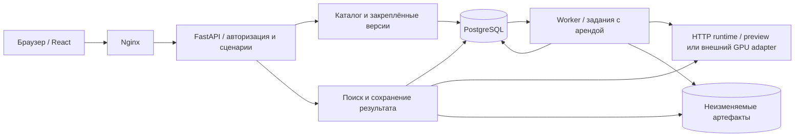

# Архитектура сервиса

Текущая реализация — самостоятельное приложение в `service/`. Исследовательские модели, обучение и экспериментальные скрипты не импортируются. По решению пользователя подключена только явно обозначенная заглушка; веса не требуются.

## Сквозной путь

Пять контейнеров: web, api, worker, runtime, postgres. Каталог и поиск имеют отдельные модули внутри API; одинаковые предметные операции используются из HTTP и worker. Клиент не рассчитывает уверенность и не меняет порядок результатов самостоятельно.

## Почему очередь находится в PostgreSQL

Задание и его предметное состояние сохраняются в одной транзакции. Worker атомарно захватывает задание с ограниченным сроком аренды, продлевает её во время работы и сохраняет результат только при владении текущим claim token. Прерванная работа становится доступной повторно; число попыток ограничено. Старый worker после передачи аренды не может затереть результат нового.

Этого достаточно для текущих импортов, объяснений и отчётов. Отдельный RabbitMQ не включён в поставку: он потребовал бы дополнительной синхронизации между брокером и каталогом. Граница постановки заданий позволяет добавить транспорт при конкретной необходимости, сохраняя идемпотентную публикацию.

## Данные

- PostgreSQL хранит галереи, версии, наблюдения и их эмбеддинги, поиски, заключения, задания, браузерные сессии, сессии импорта и сведения об экспорте. Предметные записи привязаны к workspace; отдельной таблицы рабочих пространств нет.
- Общий Docker volume хранит оригиналы, готовые отчёты и оставшиеся NPZ старого выпуска до их переноса в БД. Новые эмбеддинги сохраняются в БД без файловой копии. Пути оригиналов и отчётов создаются сервером; пользовательские имена файлов не становятся путями хранения.
- Галерея публикуется только целиком после обработки. Активация требует ожидаемую текущую версию; устаревшая форма получает конфликт.
- Поиск сохраняет конкретную версию галереи, идентификатор алгоритма, политику и оригинал запроса. Повтор с тем же Idempotency-Key возвращается к первоначальной операции.
- Заключения оператора и их нормализованные координатные пометки — отдельные неизменяемые записи.
  Они не изменяют сохранённые оценки и не обучают заглушку.
- Импорт создаёт замещающую версию: загружаются все наблюдения будущего снимка, а не неявные изменения текущего.

Хэши применяются для целостности файлов и идемпотентности запросов. Они не участвуют в ранжировании.

## Доказуемый операторский сценарий

Экспертная доска читает один сохранённый search и не пересчитывает выдачу: query, выбранный кандидат
и ближайший конкурент получают общий zoom/pan. Ручные точки ссылаются только на изображения этого
результата, сохраняются вместе с отдельным review и показываются в последующих чтениях и экспорте.

`gallery_diff` — отдельный глубокий модуль над двумя готовыми immutable snapshot. Уникальный
`external_id` позволяет показать изменение файла или BBox; записи без него сопоставляются только по
точному содержимому. Хэши используются для инвентарного сравнения версий и не попадают в поиск.
Активация после просмотра diff остаётся прежней атомарной compare-and-swap операцией.

Offline-дело формируется существующим durable export job. Архив ограничен 256 МиБ исходных файлов и
содержит реальные оригиналы/кропы, JSON, PDF, локальный HTML-viewer, manifest SHA-256 и verifier без
сетевых зависимостей. Наружный SHA-256 ZIP возвращается заданием и заголовком ETag.

## Возобновляемый импорт полной галереи

CSV с колонками `image_id,x,y,w,h` сначала проверяется и сохраняется как сессия импорта. Изображения передаются отдельными порциями; статус содержит принятые и отсутствующие `image_id`. После перезапуска клиент читает этот статус и досылает отсутствующие файлы. Повтор создания с тем же `Idempotency-Key` и тем же разобранным содержимым возвращает прежнюю сессию; другой manifest с этим ключом получает `409`.

Вся порция проверяется до фиксации её файлов в каталоге. Повтор файла с тем же именем и байтами не создаёт дубль; замена уже принятого файла или неоднозначное соответствие `image_id` отклоняется. Сессия не создаёт доступную для поиска частичную версию. Только после получения всех изображений `finalize` одной транзакцией создаёт версию `preparing`, задание и ссылки на них в сессии. Повторная или конкурентная финализация возвращает тот же job. Условное SQL-обновление строки сессии сериализует загрузку и финализацию в PostgreSQL и SQLite.

Worker рассчитывает признаки и в одной транзакции сохраняет все `FeatureArtifact`, все `Observation` и статус версии `ready`. Публикация защищена текущим claim token задания. Ошибка или потеря аренды не оставляет частично готового снимка. Переключение активной версии остаётся отдельной явной операцией.

| Ограничение | Фактическое значение |
|---|---|
| Сессия CSV | От 1 до 10 000 строк |
| CSV в браузере | Файл до 2 МиБ |
| Поле API `manifest_csv` | До 2 097 152 символов; общий JSON-запрос также ограничен по байтам |
| JSON-запрос | До `min(FALCON_MAX_REQUEST_BYTES, 4 МиБ)` |
| Одна порция изображений | До `min(FALCON_MAX_IMPORT_FILES, 100)` файлов; при настройках по умолчанию — 100 |
| Multipart-запрос | По умолчанию до 256 МиБ целиком, включая служебные границы; браузер оставляет запас для них |
| Одно изображение | По умолчанию до 20 МиБ; декодер также ограничен 20 МиБ и 24 мегапикселями |
| Прежний `/imports` | Один multipart-запрос, по умолчанию до 500 файлов; протокол сохранён для совместимости |

Сессия возвращает действующие `max_chunk_files`, `max_chunk_bytes`, `max_upload_bytes`. Nginx дополнительно ограничивает тело запроса 256 МиБ; увеличение серверной настройки требует согласованного изменения прокси. Координаты CSV — конечные целые числа с абсолютным значением не более 10 000 000; ширина и высота положительные. Пересекающая край кадра рамка обрезается до изображения при загрузке. Идентификаторы используются только для сопоставления файлов с CSV и отображения результата.

## Признаки в БД и новые таблицы

`FeatureStore` отделяет поиск от способа хранения признаков. В `feature_artifacts.payload` находится ограниченный числовой NPZ: `BYTEA` в PostgreSQL, `BLOB` в SQLite. Метаданные содержат `model_id`, размерность, `dtype=float32`, `encoding=numeric-npz-v1` и SHA-256. Перед использованием проверяются контрольная сумма, формат, размерность и версия модели; загрузка массивов всегда выполняется с `allow_pickle=False`. Повреждённая запись БД возвращает `feature_corrupt`/503 и не заменяется файловым кешем.

| Новая таблица | Данные и связи | Индексы и ограничения |
|---|---|---|
| `feature_artifacts` | Байты признака, workspace и метаданные. `observations.feature_key` ссылается на `key` по прикладному контракту; отдельный SQL FK не добавлен для совместимости старых записей. | Первичный ключ `key`; индекс `workspace`. |
| `import_sessions` | Workspace, FK на галерею, ключ идемпотентности и хэш запроса, состояние, ревизия блокировки, nullable FK на job и версию. | Первичный ключ `id`; индексы `workspace`, `gallery_id`; уникальная пара `(workspace, idempotency_key)`. |
| `import_items` | FK на сессию, исходный `image_id` и BBox, порядок manifest, принятое имя и хэш файла, серверный ключ оригинала, проверенные размеры и BBox. | Первичный ключ `id`; индекс `session_id`; уникальная пара `(session_id, image_id)`. Доступ к строкам идёт через сессию проверенного workspace. |

При поиске признаки выбранной версии читаются из БД в память, затем выполняется **точный поиск** по скалярным произведениям. SQL-индексы таблиц обслуживают выборку и целостность; они не являются ANN-индексом. Опциональный `FAISS IndexFlatIP` также выполняет точный поиск. Запросы обрабатываются независимо; эмбеддинг запроса хранится только на время вычисления, а replay рассчитывает его заново. Идемпотентный повтор уже завершённого поиска возвращает сохранённый результат без пересчёта.

## Граница заглушки

`inference` предоставляет небольшой интерфейс: получить признак, ранжировать галерею и запросить диагностическое объяснение. Внутрипроцессный `PreviewEncoder` и `RemoteEncoder` используют одну модель данных. В Compose запрос проходит реальную HTTP-границу с bearer-аутентификацией и бинарной передачей массивов.

Заглушка рассчитывает простой RGB-дескриптор для проверки полного пути обработки. Её идентификатор содержит `NOT-REID`; статус всегда `calibration_unavailable`, принятых совпадений нет. Подтверждать автомобиль по этому результату сервис не может. `RepositoryEncoder` явно отключён; случайного перехода к обученной модели или скачивания весов нет.

GPU-профиль не встраивает ML-зависимости в API. Он заменяет только образ `runtime`, резервирует NVIDIA
GPU и монтирует внешний bundle в `/models` read-only. До запуска проверяются полный список файлов,
размеры, SHA-256, суммарный вес и совпадение образа/model_id с манифестом. После запуска `RemoteEncoder`
валидирует capability handshake; несовпадение `FALCON_EXPECTED_MODEL_ID` делает сервис неготовым.
Обычный Compose не применяет этот профиль и продолжает явно использовать preview.

Карта объяснения демонстрирует работу асинхронного интерфейса: измеряется изменение косинуса заглушки при перекрытии областей. Используются отдельные уменьшенные представления до 512 пикселей по стороне. Метод, разрешение и отличие от исходной оценки входят в результат. Исходники и сохранённый поиск остаются прежними.

## Доступ

Интерфейс открывается без формы входа: браузер проверяет существующую сессию и при её отсутствии создаёт локальную через `POST /auth/local-session`. Этот путь включён в localhost-профиле Compose и требует разрешённого loopback Origin и Host. Используется только существующая административная учётная запись внутреннего workspace `local`, поэтому галереи и история сохраняются. Для отдельного API `FALCON_LOCAL_AUTO_LOGIN` по умолчанию выключен; при сетевом развёртывании его также выключают.

Сервер выдаёт HttpOnly-сессию и отдельный CSRF-токен; изменяющие запросы проверяют Origin и CSRF. В БД хранится хэш сессии. Интеграция передаёт bearer token; явный обмен токена на сессию остаётся частью API. Отзыв исходного токена отменяет связанный доступ. Роли: viewer, operator, admin; каждая привязана к внутреннему workspace, который не показывается в интерфейсе.

Проверка workspace действует на галереи, результаты, изображения, задания и скачивание файлов. Чужой объект не становится доступным через угаданный ID или старую ссылку. Внешние URL для загрузки изображений не принимаются.

## Ошибки и эксплуатация

Ошибки имеют стабильный код, сообщение и request ID. Некорректный вход, отсутствие готовой галереи, недоступность runtime и отсутствие калибровки различаются. Техническая ошибка не преобразуется в отказ модели.

API сохраняет реальные измерения этапов обработки. Системный экран показывает данные своего workspace; задержки заглушки не называются производительностью ReID. Проверки readiness включают зависимости, worker имеет отдельную проверку состояния.

## Обновление существующей установки и откат

При запуске `Database.initialize()` вызывает `create_all`: существующие таблицы и данные сохраняются, три отсутствующие таблицы и их индексы создаются автоматически. В PostgreSQL создание схемы сериализовано advisory lock, поскольку API и worker могут стартовать одновременно. Это добавочное обновление текущего выпуска, а не механизм изменения произвольных существующих колонок; для последующих изменений таких колонок нужны отдельные версионированные миграции.

Старые `observations.feature_key` сохраняют прежние значения. Если соответствующей записи в `feature_artifacts` ещё нет, первое чтение версии переносит признак из старого NPZ в БД после проверки формата и совместимости модели. Конкурентные переносы используют `INSERT ... ON CONFLICT DO NOTHING`. Архивы ограничены по размеру и распакованному содержимому. После переноса БД становится единственным источником этого признака.

**Старые NPZ необходимо сохранять, пока не перенесены все нужные версии, включая версии исторических поисков.** Сам запуск обновлённого приложения не означает завершения переноса: он происходит при обращении к каждой версии. Если до переноса исчезнет файл, поиск вернёт `feature_unavailable`/503. Для новых снимков NPZ на диске не требуется.

Перед обновлением следует согласованно сохранить БД и volume оригиналов, отчётов и старых признаков. **Откат только Docker-образа на прежний выпуск несовместим с новыми снимками:** прежний код ищет их признаки в файлах, которых новый выпуск не создаёт. Безопасный возврат к старому формату требует восстановления согласованной резервной копии до обновления либо отдельно подготовленного совместимого механизма переноса. Восстановление такой копии исключает из восстановленного состояния операции, выполненные после её создания. Автоматический downgrade не реализован.

Поведенческие проверки импорта, хранения и совместимости описаны в [IMPLEMENTATION](IMPLEMENTATION.md); результаты конкретных прогонов находятся в [VALIDATION](VALIDATION.md).

## Дальнейшее подключение модели

Сервисная граница и GPU-деплой подготовлены; следующий этап модельной команды — передать настоящий
runtime-образ и bundle по [контракту](GPU_RUNTIME.md), затем отдельно проверить численный паритет,
калибровку и официальный benchmark. Масштабирование ANN на миллион, качество распознавания и
отказоустойчивость нескольких узлов этим выпуском не измеряются и не заявляются.
