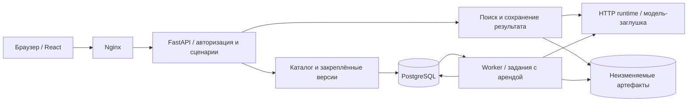

# Архитектура сервиса

Текущая реализация — самостоятельное приложение в `service/`. Исследовательские модели, обучение и экспериментальные скрипты не импортируются. По решению пользователя подключена только явно обозначенная заглушка; веса не требуются.

## Сквозной путь

Пять контейнеров: web, api, worker, runtime, postgres. Каталог и поиск имеют отдельные модули внутри API; одинаковые предметные операции используются из HTTP и worker. Клиент не рассчитывает уверенность и не меняет порядок результатов самостоятельно.

## Почему очередь находится в PostgreSQL

Задание и его предметное состояние сохраняются в одной транзакции. Worker атомарно захватывает задание с ограниченным сроком аренды, продлевает её во время работы и сохраняет результат только при владении текущим claim token. Прерванная работа становится доступной повторно; число попыток ограничено. Старый worker после передачи аренды не может затереть результат нового.

Этого достаточно для текущих импортов, объяснений и отчётов. Отдельный RabbitMQ не включён в поставку: он потребовал бы дополнительной синхронизации между брокером и каталогом. Граница постановки заданий позволяет добавить транспорт при конкретной необходимости, сохраняя идемпотентную публикацию.

## Данные

- PostgreSQL хранит рабочие пространства, галереи, версии, наблюдения, поиски, заключения, задания, сессии и сведения об экспорте.
- Общий Docker volume хранит оригиналы, признаки и готовые отчёты. Пути создаются сервером; пользовательские имена файлов не становятся путями хранения.
- Галерея публикуется только целиком после обработки. Активация требует ожидаемую текущую версию; устаревшая форма получает конфликт.
- Поиск сохраняет конкретную версию галереи, идентификатор алгоритма, политику и оригинал запроса. Повтор с тем же Idempotency-Key возвращается к первоначальной операции.
- Заключения оператора — отдельные записи. Они не изменяют сохранённые оценки и не обучают заглушку.
- Импорт создаёт замещающую версию: загружаются все наблюдения будущего снимка, а не неявные изменения текущего.

Хэши применяются для целостности файлов и идемпотентности запросов. Они не участвуют в ранжировании.

## Граница заглушки

`inference` предоставляет небольшой интерфейс: получить признак, ранжировать галерею и запросить диагностическое объяснение. Внутрипроцессный `PreviewEncoder` и `RemoteEncoder` используют одну модель данных. В Compose запрос проходит реальную HTTP-границу с bearer-аутентификацией и бинарной передачей массивов.

Заглушка рассчитывает простой RGB-дескриптор для проверки полного пути обработки. Её идентификатор содержит `NOT-REID`; статус всегда `calibration_unavailable`, принятых совпадений нет. Подтверждать автомобиль по этому результату сервис не может. `RepositoryEncoder` явно отключён; случайного перехода к обученной модели или скачивания весов нет.

Карта объяснения демонстрирует работу асинхронного интерфейса: измеряется изменение косинуса заглушки при перекрытии областей. Используются отдельные уменьшенные представления до 512 пикселей по стороне. Метод, разрешение и отличие от исходной оценки входят в результат. Исходники и сохранённый поиск остаются прежними.

## Доступ

Интеграция передаёт bearer token. Браузер обменивает токен на HttpOnly-сессию и отдельный CSRF-токен; изменяющие запросы проверяют Origin и CSRF. В БД хранится хэш сессии. Отзыв исходного токена отменяет связанный доступ. Роли: viewer, operator, admin; каждая привязана к workspace.

Проверка workspace действует на галереи, результаты, изображения, задания и скачивание файлов. Чужой объект не становится доступным через угаданный ID или старую ссылку. Внешние URL для загрузки изображений не принимаются.

## Ошибки и эксплуатация

Ошибки имеют стабильный код, сообщение и request ID. Некорректный вход, отсутствие готовой галереи, недоступность runtime и отсутствие калибровки различаются. Техническая ошибка не преобразуется в отказ модели.

API сохраняет реальные измерения этапов обработки. Системный экран показывает данные своего workspace; задержки заглушки не называются производительностью ReID. Проверки readiness включают зависимости, worker имеет отдельную проверку состояния.

Первичная схема создаётся автоматически в выделенной БД. Текущая версия не мигрирует существующие сторонние таблицы. Перед будущими изменениями схемы нужны явные версионированные миграции и проверка отката. Для резервного копирования следует сохранять БД и volume артефактов согласованно.

## Дальнейшее подключение модели

Следующий этап потребует настоящего адаптера, объявленного model bundle и проверки численного паритета/калибровки. Он намеренно отделён от этой реализации. Масштабирование ANN на миллион, качество распознавания и отказоустойчивость нескольких узлов этим выпуском не измеряются и не заявляются.
