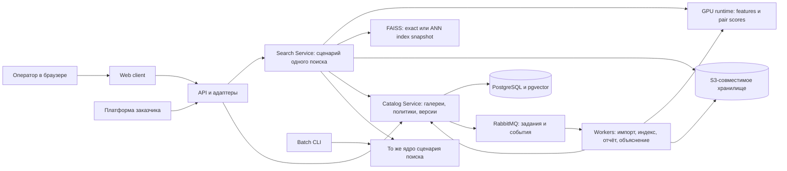

# Идеальный сервис визуального сопоставления автомобилей

Продуктовая и архитектурная спецификация для задачи «Фалькон Тех», ЛЦТ 2026. Исследование от 21 сентября 2026 года.

**Целевой продукт: профессиональное рабочее место визуального сопоставления автомобилей и автономный ReID-сервис, который заказчик может встроить в собственную платформу.** Оператор получает проверяемый результат по изображению и BBox; инженер получает устойчивый API; руководитель эксплуатации — управляемую систему с понятными версиями, состояниями и показателями.

Документ описывает желаемый сервис без ограничений на бюджет разработки и инфраструктуры. Все функции ниже — предложения, а не заявление о том, что они уже реализованы. Сохраняются обязательные ограничения конкурса: независимость запросов, запрет признаков номера, заданное оборудование проверки, общий размер инференсных весов и автономный запуск.

## 1. Что удалось выяснить о заказчике

Исследование опирается на предоставленное ТЗ и первичные публикации компании. Следующие выводы о привлекательности продукта — наша интерпретация этих источников, а не неизвестные требования жюри.

| Публичный сигнал | Архитектурный и продуктовый ответ |
|---|---|
| Компания описывает платформу из изолированных компонентов, взаимодействующих через API | ReID как подключаемая функциональность с небольшим стабильным контрактом |
| В собственном стеке названы React/TypeScript, PostgreSQL, RabbitMQ, Triton и средства наблюдаемости | Совместимые форматы интеграции, событий и мониторинга; знакомый интерфейс эксплуатации |
| В статье об архитектуре ядро отделено от транспорта и инфраструктуры | Один сценарий поиска через CLI, HTTP и события, проверяемый без сети и базы |
| В статье о нагрузке акцент на предсказуемой длительной работе | Контролируемая очередь, измеряемый p95, восстановление и отсутствие скрытых режимов деградации |
| Публикация о конкурсе подчёркивает внешний облик автомобиля и работающий прототип | В центре демонстрации — реальные изображения, детали сравнения, кандидаты и обоснованный отказ |

Источники: [технологическая платформа](https://habr.com/ru/companies/falcontech/articles/1039094/), [Clean Architecture и GRASP](https://habr.com/ru/companies/falcontech/articles/1051438/), [устойчивость видеоаналитики](https://habr.com/ru/companies/falcontech/articles/1071954/), [задача хакатона](https://habr.com/ru/companies/falcontech/articles/1077254/).

В последней публикации есть упоминание событий с известным номером. Для конкурсного решения действует прямой запрет ТЗ: номера и остаточные признаки номера не используются. Внешняя публикация не расширяет разрешённый вход модели.

**Продуктовая позиция:** «По обезличенному кадру находим вероятные визуальные совпадения, показываем основания для проверки и сохраняем воспроизводимый результат. Сервис работает автономно и подключается к вашей платформе».

## 2. Пользователи и законченные сценарии

| Пользователь | Его задача | Признак хорошего продукта |
|---|---|---|
| Оператор | Быстро проверить несколько вероятных совпадений | Крупные изображения, минимум переходов, ясный отказ, сохранение результата |
| Эксперт по качеству | Понять ошибки и допустимость порога | Размеченные контрольные наборы, кривые F1/TNR, срезы и воспроизводимые сравнения |
| Интегратор | Подключить существующий источник изображений | OpenAPI, примеры, типизированные ошибки, тестовый отправитель, одинаковые результаты разных адаптеров |
| Администратор | Загружать галереи и обновлять модель без повреждения работы | Версии, предварительная проверка, атомарная публикация, откат |
| Руководитель / жюри | Увидеть практическую ценность и достоверность | Цельный сценарий, работа без сети, честные замеры и ограничения |

Основной путь: **выбрать доступную галерею → загрузить изображение и BBox → получить кандидатов или отказ → сравнить изображения → сохранить заключение оператора и экспорт**.

Повторный просмотр результата открывает тот же исходный кадр, тот же список и ту же версию галереи. Поиск по обновлённой галерее — новое явно названное действие, а не незаметное изменение старого результата.

## 3. Обязательные возможности по ТЗ

### Приём данных

- JPEG и PNG, исходный кадр и координаты `x,y,w,h` в пикселях; одинаковая семантика через UI и API.
- Отображение BBox поверх оригинала и отдельной вырезки именно того изображения, которое поступает в модель.
- Несколько наблюдений с разными BBox могут ссылаться на один исходный кадр. `observation_id` отделён от `image_id`.
- Проверка формата, декодирования, размеров, конечности координат и пересечения BBox с кадром. Политика обрезания по границе документирована.
- Прозрачные ошибки: «файл повреждён», «рамка вне изображения», «галерея ещё обрабатывается».

### Цифровой признак и поиск

- Фиксированная размерность эмбеддинга, float32 на публичном выходе, заданная L2-нормализация.
- Поиск по разрешённой галерее, ранжированный top-N и отдельное решение о наличии достаточно уверенного кандидата.
- Работа с ранее не виденными идентичностями; истинный vehicle_id не нужен для рабочего поиска.
- Каждый запрос вычисляется независимо от других запросов. Пакетирование обеспечивает только вычислительную эффективность.

### Отказ

- Принятый список или пустой принятый список; уверенность и обоснованный порог.
- Числовая шкала объяснена. Z-score и cosine не подписываются как вероятность в процентах.
- Сервис отличает модельный отказ от неподходящей калибровки, ошибки инфраструктуры и некорректного входа.

В базовом профиле с решением по top-1 поле `accepted_candidates` содержит только итогового первого кандидата либо пустой список. `ranked_candidates` содержит top-N вариантов для просмотра; остальные не считаются автоматически принятыми. Несколько принятых кандидатов требуют отдельно проверенного правила принятия пар. Конкурсный `submission.csv` в обоих случаях сохраняет требуемый top-10.

### Инженерный контракт

- Раздельные компоненты клиента, backend/инференса и хранения; backend на разрешённом языке, Linux и открытый стек.
- Документированные API через OpenAPI; браузерный thin client.
- Dockerfile и Docker Compose, запуск готового комплекта одной командой, runtime без внешнего интернета.
- Все необходимые веса поставляются вместе с решением; суммарно не более 2 ГБ по конкурсному правилу. Вспомогательные модели тоже учитываются.
- Исходники обучения и инференса, точные зависимости, происхождение внешних данных/весов, инструкции и результаты валидации.
- Конкурсный экспорт: top-10 для каждого query в `submission.csv`, `candidates.csv` с корректным отказом, `embeddings.npy` в установленном порядке. Это отдельный экспортный адаптер того же ядра.

Развёрнутая привязка к пунктам ТЗ и демонстрация выполнения — в [матрице требований](REQUIREMENTS_AND_DEMO.md).

## 4. Как выглядит основной экран

Рабочее название интерфейса: **«Фалькон · Визуальный поиск»**. Название условное; согласование бренда входит в передачу продукта.

```text
┌─────────────────────────────────────────────────────────────────────────┐
│ Визуальный поиск      Галерея: [выбранная]          Сервис готов          │
├────────────┬────────────────────────┬───────────────────────────────────┤
│ Поиск      │ Исходный кадр          │ Результат поиска                  │
│ Галереи    │ ┌────────────────────┐ │ «Есть кандидаты для проверки»     │
│ Результаты │ │ кадр + точный BBox  │ │ Галерея: N наблюдений · t мс      │
│ Качество   │ └────────────────────┘ │                                   │
│ Интеграция │                        │ ┌──────────┐ ┌──────────┐         │
│ Система    │ Что анализирует модель │ │ №1 фото  │ │ №2 фото  │ ...     │
│            │ ┌────────────────────┐ │ └──────────┘ └──────────┘         │
│            │ вырезка автомобиля  │ │ [Сравнить] [Сохранить результат]  │
│            │ без искажения вида  │ │                                   │
│            │                    │ │ Остальные кандидаты               │
│            └────────────────────┘ │ [Показать все 10]                 │
│            [Выбрать файл] [Найти]  │                                   │
└────────────┴────────────────────────┴───────────────────────────────────┘
```

Схема показывает структуру, а не измеренные данные. N и t подставляются из настоящего результата. На широком экране исходный запрос занимает примерно треть рабочей области, кандидаты — две трети. Левое меню компактное. Главная визуальная площадь отдана изображениям, их ракурс и детали читаются без открытия каждого файла.

Кадры отображаются с сохранением пропорций; допустимы нейтральные поля. Модельный resize не должен растягивать автомобиль в основном сравнении. BBox можно уточнить при ручном вводе; изменение создаёт новый запрос с новой вырезкой и сохраняет исходную рамку в истории.

У каждой карточки есть номер в ранжировании, изображение, короткий идентификатор наблюдения и действие сравнения. Прошедший порог top-1 отмечен «Предложен моделью»; остальные подписаны «Альтернативы для просмотра». Ни одна отметка не означает установленную идентичность. Подтверждение оператора отображается отдельно. При отказе альтернативы доступны только в раскрываемой диагностике.

Численные технические сведения раскрываются по действию «Подробности результата»: версия алгоритма, шкала, порог, время вычисления, версия галереи. На основном экране оператор видит полезный ответ и изображения.

### Визуальная система

Сдержанный графитовый фон рабочей области, нейтральные панели, белый текст; фиолетовый акцент для основного действия и выбранного объекта соответствует визуальному контексту ТЗ. Изображения не тонируются. Отказ оформляется спокойным нейтральным статусом, неисправность — отдельным красным, сомнение/ограничение — янтарным. У каждого цвета есть текстовый смысл и иконка.

Дневная тема с такой же структурой; масштаб интерфейса; клавиатурная навигация; заметный фокус; контраст и управление без drag-only действий. Горячие клавиши описаны в интерфейсе и не мешают вводу. Все шрифты и ресурсы поставляются локально. Число экранов с настройками ограничено задачами роли: оператор не попадает в панели калибровки случайно.

## 5. Семь продуктовых возможностей, которые создают сильное впечатление

### 5.1. Парная экспертиза на одном экране

Нажатие на кандидата открывает крупное сравнение «запрос ↔ кандидат». Оригинал, BBox и вырезка всегда доступны. Есть независимый зум и опциональная синхронизация масштаба; при разных ракурсах панорамирование не предполагает геометрического совпадения координат. Пиксели можно рассмотреть без генеративного дорисовывания деталей.

Третий снимок можно закрепить как альтернативу, чтобы сравнить похожие кузова/цвета. Это просмотр уже найденных кандидатов: выбор оператора не изменяет алгоритмический ranking. Его заключения — «считаю совпадением», «не совпадает», «недостаточно данных» — сохраняются отдельно от модельного ответа.

**Польза:** оператор принимает решение по исходным материалам, а не по маленькой картинке и одному числу. Это развитие обязательного веб-интерфейса и продуктовой зрелости из §10 ТЗ.

### 5.2. Объяснение для конкретной пары

Кнопка «Что повлияло на сравнение» запускает отдельную задачу. На двух изображениях появляются рассчитанные области влияния, с названием метода и легендой. Предпочтительный вариант — чувствительность score выбранной пары к локальному закрытию областей; attention/Grad-CAM допустимы при корректном подключении к используемой модели.

Показывается величина изменения выбранного score, а не выдуманное утверждение «это одна машина из-за царапины». Основной объясняемый выход реранкера — score конкретной пары. Тепловая карта — диагностическая интерпретация чувствительности модели, а не доказательство физического совпадения. Использование остаточных признаков номера запрещено. Карта с концентрацией на области номера требует проверки нарушения и не предъявляется как корректное обоснование совпадения; одного размытия входных номеров недостаточно, чтобы заявлять доказанную независимость модели от этой области.

Оператор может переключить overlay и исходные пиксели. Результат основного поиска остаётся неизменным. Объяснение кэшируется по версии алгоритма, входам, параметрам и выбранному методу и работает без облачного API. Если дополнительно объясняется изменение места в ranking, фиксируются и входят в ключ кэша gallery snapshot, search profile, состав окна и исходные оценки остальных кандидатов.

**Польза:** это прямое выполнение критерия интерпретируемости и инструмент разбирательства спорных результатов.

### 5.3. Отказ как полезный результат

У отказа есть полноценная карточка: «Уверенного совпадения в выбранной галерее не найдено». Ниже — понятные условия выполненного поиска и следующий шаг: проверить BBox, посмотреть диагностические похожие кадры либо сохранить результат.

Если доступны объективно измеренные свойства изображения — размер вырезки, размытость, недоэкспонирование, — они показываются как характеристики входа. Нельзя автоматически утверждать, что именно они стали причиной отказа. Для «нескольких близких снимков» нельзя без разметки заявлять, что это разные автомобили.

Диагностические похожие изображения открываются отдельным действием и не превращаются в принятые совпадения. В официальном `candidates.csv` отказ остаётся отсутствием строк.

**Польза:** заказчик видит зрелый open-set сценарий, в котором алгоритм не вынуждает оператора верить самому похожему объекту.

### 5.4. Паспорт результата с воспроизведением

У каждого поиска есть постоянная карточка: запрос, BBox, ранжирование, решение, заключение оператора и источник данных. Технический паспорт содержит hashes файлов, версии модели/индекса/калибровки, параметры обработки, timestamp выполнения и trace ID.

Экспорт PDF для человека и JSON/CSV для интеграции строится из одной записи. Файлы экспортного комплекта имеют manifest и контрольные суммы. Они подтверждают целостность комплекта; сами по себе hashes не устанавливают идентичность автомобиля и не означают юридическую доказательность.

Кнопка «Воспроизвести» запускает тот же запрос на сохранённом snapshot и сообщает совпадение результата либо конкретную причину различия. Если исходные данные удалены по политике хранения, карточка честно показывает, что точное воспроизведение больше недоступно.

**Польза:** спорный ответ можно передать другому оператору, техподдержке и ML-инженеру без пересказа условий.

### 5.5. Галерея с понятным состоянием и историей

Оператор видит, по чему именно ищет: число наблюдений, версию, дату публикации, охват обработки и статус готовности. Администратор видит принятые и отклонённые строки импорта, ошибки файлов, несовместимость признаков и прогресс индексирования.

Загрузка новой версии не останавливает поиск по текущей. Перед публикацией проверяются полнота, соответствие весов/признаков, индекс и применимость калибровки. Публикация атомарна. Старые результаты сохраняют связь со старой версией.

«Галерея из миллиона» означает миллион наблюдений с объявленным происхождением данных; количество уникальных автомобилей показывается только при достоверной разметке. Никакой неявной склейки по предсказанным идентичностям.

**Польза:** эксплуатация предсказуема, поиск не зависит от того, успел ли фоновый процесс обработать половину новой базы.

### 5.6. Готовое подключение к платформе заказчика

В разделе «Интеграция» находятся OpenAPI, примеры запросов, небольшой клиент Python и пример HTTP/RabbitMQ producer. Внешняя система отправляет независимое наблюдение «изображение + BBox + id», получает цифровой признак и/или результат поиска с типизированным статусом.

Режим потока показывает поступающие независимые запросы и их результаты, задержку и состояние доставки. Это событийная обработка кадров, а не трекинг: прошлые query не влияют на следующий. Отправитель повторяет сообщение после разрыва связи с тем же ключом идемпотентности; сервис не создаёт дублирующих side effects.

Функция поиска предоставляется и через встраиваемый web-компонент с ограниченным контрактом аутентификации. Отдельная демонстрация на двух локальных приложениях показывает, как компонент будет работать внутри существующего рабочего места.

**Польза:** заказчик может оценить конкретную стоимость интеграции по документации и работающему примеру, а не по общему обещанию «у нас есть API».

### 5.7. Обновление модели с видимым сравнением и откатом

Новая модель сначала готовит новую версию признаков и индекса. Затем в теневом режиме сравниваются результаты фиксированного набора: качество при наличии меток, изменения ranking/refusal, latency, ошибки и отклонения по срезам.

Экран «Изменения версии» показывает, какие примеры новая версия исправила, какие ухудшила и что происходит с отказами. Активация требует совместимого model/index/calibration bundle. Откат переключает комплект целиком; старый threshold не переносится молча на новые embeddings.

**Польза:** сервис можно развивать после конкурса без потери управляемости. Это сильный аргумент для тех, кому предстоит его сопровождать.

## 6. Все основные экраны

| Экран | Содержимое | Основное действие |
|---|---|---|
| Поиск | Исходный кадр, BBox, crop, gallery, ranking/refusal | Найти и сравнить |
| Сравнение | 2–3 крупных изображения, детали пары, объяснение, заключение | Сохранить проверку |
| Результаты | История запросов, поиск по request id, статусы, автор, экспорт | Открыть сохранённый результат |
| Галереи | Импорт, версии, готовность, ошибки, публикация и откат | Опубликовать проверенную версию |
| Качество | Контрольные наборы, F1/TNR, отказ/покрытие, срезы, версии | Утвердить проверенную политику |
| Интеграция | OpenAPI, примеры, событие→ответ, sandbox, диагностика | Отправить первый настоящий запрос |
| Система | Состояние зависимостей, очередей, worker-ов, latency и версий | Найти причину сбоя |

Экран качества доступен роли эксперта. График позволяет изучать порог на размеченной валидации, но не незаметно менять production или конкурсный режим. Несколько операционных политик допустимы только с отдельной валидацией и понятным назначением. На конкурс сдаётся один зафиксированный operating point.

## 7. Статусы ответа: важная часть продукта

| Статус | Что он означает | Что видит оператор |
|---|---|---|
| `candidates` | Политика разрешила предложить кандидата | В базовом профиле — принятый top-1; остальные варианты отмечены отдельно |
| `no_confident_match` | Поиск выполнен в допустимых условиях, порог не пройден | Полноценный отказ и следующий шаг |
| `calibration_unavailable` | Условия галереи/алгоритма не покрыты политикой уверенности | Ограничение режима; диагностический ranking отдельно |
| `gallery_not_ready` | Версия не опубликована либо недоступна | Прогресс или причина недоступности |
| `invalid_input` | Некорректные файл/BBox | Точное сообщение, что исправить |
| `overloaded` / `timeout` | Сервис не завершил обработку в пределах контракта | Предложение повторить, идентификатор запроса |
| `failed` | Техническая ошибка | Ошибка обработки, сохранённая диагностика |

Не вводить непроверенную третью модельную категорию «возможно» как будто она калибрована. Визуальные сложности и экспертные комментарии допустимы, но официальный результат остаётся «кандидаты / отказ». Нельзя маскировать неполную gallery или упавший worker под отсутствие совпадений.

Порог зависит от конкретной шкалы, модели и распределения галереи. Маленькая демонстрационная галерея и большой городской архив не считаются автоматически одинаковыми условиями калибровки. Каждый профиль требует проверенной политики либо явного режима ranking без заявления о калиброванном отказе. Для конкурса фиксируется ровно предусмотренная постановка.

## 8. Целевая архитектура

### Логические компоненты



Это схема ответственности, не требование держать каждую коробку отдельным процессом. FAISS — библиотека и производный индекс внутри search workers; ядро — библиотека. Физическое разделение следует границам нагрузки и отказа.

| Компонент | Владеет | Причина отдельной границы |
|---|---|---|
| Web + reverse proxy | Отображение, пользовательская навигация | Тонкий клиент без математических решений |
| API / адаптеры | Аутентификация, контракты, авторизация операций, идемпотентность | Подключение браузера и внешних систем |
| Catalog Service | Галереи, observation metadata, версии, политика публикации, jobs | Один владелец изменений состояния |
| Search Service | Полный сценарий поиска, pinned snapshot, shortlist, refusal | Одинаковая бизнес-логика для всех клиентов |
| GPU runtime | Загруженные модели, batch scheduling, features/pair inference | Масштабирование GPU независимо от БД/UI |
| Async workers | Импорт, построение индекса, explain/export tasks | Долгие задачи не ухудшают interactive response |

**Рекомендуемый стек:** React + TypeScript; Python/FastAPI для API и сервисных сценариев; PyTorch для проверенного ML runtime; PostgreSQL + pgvector как каноническое хранение глобальных векторов и метаданных; FAISS как материализованный точный/ANN индекс; S3-совместимое хранилище; RabbitMQ; OpenTelemetry, Prometheus/Grafana и сбор журналов.

Точный выбор версий и реализаций S3/identity относится к спецификации сборки. Предпочтение открытым компонентам, все зависимости закрепляются и поставляются локально. PostgreSQL хранит канонические записи, FAISS можно полностью восстановить из опубликованного snapshot: это не две независимые базы истины.

FAISS обеспечивает exact inner-product search и различные ANN индексы; для cosine используются нормированные векторы. Exact режим нужен как воспроизводимый конкурсный путь и эталон ANN. [Официальные типы индексов FAISS](https://github.com/facebookresearch/faiss/wiki/Faiss-indexes). pgvector предоставляет типы и операции хранения/поиска векторов внутри PostgreSQL. [Документация pgvector](https://github.com/pgvector/pgvector).

### Один математический сценарий

1. Проверить пользователя, доступ к gallery и вход.
2. Зафиксировать опубликованный комплект `(model_bundle, gallery_snapshot, search_profile, calibration_policy)`.
3. Декодировать исходное изображение, обрезать BBox, применить ровно версионированный preprocessing.
4. Получить global embedding и необходимые токены выбранным вычислительным путём.
5. Найти shortlist в разрешённом snapshot: exact для конкурсной галереи, объявленный ANN для большого профиля.
6. Выполнить exact rescore shortlisted global vectors и pair rerank в заданном окне.
7. Посчитать query-level confidence в согласованной шкале и применить frozen policy.
8. Сохранить immutable result, вернуть response и ссылку на него. Объяснение/отчёт запускаются независимо по запросу.

Из UI, HTTP, event adapter и CLI вызывается одна библиотека сценария с одинаковыми входами. Batch не заменяет поиск специальной реализацией по общей матрице query→query. Ground truth, camera_id и сведения о других запросах недоступны runtime.

### Выполнение на GPU

У каждой реплики ограниченная очередь, deadline и выделенный владелец mutable buffers. Модель загружается один раз, работает в eval-mode; batching разрешён только при доказанной независимости результатов. Interactive и фоновые очереди имеют отдельные классы обслуживания; фоновые импорты не захватывают весь GPU pool.

В масштабе города GPU runtime может обслуживаться через Triton с версионированными tensor contracts и dynamic batching. Перенос на Triton/ONNX/TensorRT требует численного паритета и повторной проверки качества; это адаптер исполнения, не новая бизнес-логика. [Конфигурация и batching Triton](https://docs.nvidia.com/deeplearning/triton-inference-server/user-guide/docs/user_guide/model_configuration.html).

Брокер обслуживает долгие задания и интеграционные события; синхронный интерактивный поиск не обязан совершать лишний круг через него. В обработке событий используются acknowledgements, bounded retry и идемпотентность: при сбое доставка может повториться. [Модель надёжности RabbitMQ](https://www.rabbitmq.com/docs/reliability).

## 9. Версии, галерея и калибровка

### Что составляет поисковый комплект

**Model bundle:** веса encoder/reranker/разрешённых вспомогательных компонентов, SHA256 и bytes, preprocessing, compute/storage dtype, размерность, runtime и источники.

**Gallery snapshot:** список разрешённых observation IDs, global vectors, token references, mapping индекса, версия модели, контрольные суммы и статистики confidence.

**Search profile:** exact/ANN, параметры индекса, rescore window, reranking window/weight, политика tie handling, запрет на запрещённые входы.

**Calibration policy:** определение confidence, operating threshold, валидированная область применения, происхождение контрольных данных, результаты и дата утверждения.

Одинаковая размерность двух embedding spaces не означает их совместимость. Политика проверяет все четыре части, а не только существование файлов.

### Публикация галереи

`draft → ingesting → features_ready → index_ready → validated → active → retired`.

Валидация не выдумывает качество ReID без меток. Она проверяет completeness, shapes, checksums, совместимость и наличие применимой политики. Для измерения качества используются отдельные размеченные наборы.

Catalog записывает изменения metadata и outbox в одной транзакции. Workers строят immutable artifacts, отправляют результат через идемпотентный контракт Catalog. Перед активацией serving replicas загружают и проверяют snapshot. Active pointer переключается атомарно; запросы со старой версией завершаются на ней. Отмена импорта не повреждает активную галерею. Если worker перезапустился, состояние задания восстанавливается по durable records.

Повтор с тем же `Idempotency-Key` и тем же содержимым возвращает или продолжает исходную операцию на первоначально закреплённом комплекте, даже если активная версия уже изменилась. Ключ ограничен пользователем/рабочим пространством и операцией; другое содержимое с прежним ключом даёт конфликт. Новый осознанный поиск по обновлённой галерее получает новый ключ.

Readiness процесса доступна и при пустой установке: пользователь должен суметь загрузить первую галерею. Готовность конкретного snapshot проверяется отдельно. Политика удаления учитывает активные запросы, сохранённые результаты и срок воспроизведения.

### Доступ и выбор галереи

Поиск выполняется только по наблюдениям, доступным пользователю/интеграции. Scope авторизации определяется до retrieval, а не постфильтром после top-10. Иначе меняются полнота, статистика confidence и риск раскрытия чужих объектов. Для изолированных рабочих пространств используются отдельные versioned snapshots или эквивалентно проверенное scoped-index решение.

Профили/фильтры, меняющие состав галереи, могут менять применимость порога. UI не предлагает произвольный фильтр, который незаметно сохраняет неподходящую калибровку. В конкурсном профиле нет camera/time/location признаков или фильтров.

## 10. Данные и API

Основные сущности: Workspace, Observation, Gallery, GalleryVersion, ModelBundle, SearchProfile, CalibrationPolicy, SearchResult, OperatorReview, Job, ExportArtifact, AuditEvent. У Observation есть исходный image reference и BBox; у OperatorReview — автор и собственное заключение, которое не переписывает SearchResult.

Основные группы публичного контракта:

| Операция | Вход / выход |
|---|---|
| `POST /v1/embeddings` | image + BBox → float32 embedding и version |
| `POST /v1/searches` | image + BBox + gallery reference → result или typed status |
| `GET /v1/searches` | История доступных результатов с пагинацией и фильтрами статуса |
| `GET /v1/searches/{id}` | Сохранённый ответ с учётом scope |
| `POST /v1/searches/{id}/replays` | Новый проверочный запуск на закреплённых версиях или явная причина недоступности |
| `POST /v1/searches/{id}/explanations` | Выбранная пара + метод → asynchronous job |
| `POST /v1/searches/{id}/exports` | Формат → export job |
| `POST /v1/searches/{id}/reviews` | Заключение оператора → отдельная запись |
| `POST /v1/galleries`, `POST /v1/galleries/{id}/imports` | Создание и импорт с BBox/manifest |
| `GET /v1/galleries`, `GET /v1/galleries/{id}/versions` | Доступные галереи, опубликованные и обрабатываемые версии |
| `POST /v1/galleries/{id}/versions/{version}/activate` | Атомарная публикация проверенного комплекта |
| `GET /v1/jobs/{id}` | Прогресс и типизированная ошибка |
| `GET /v1/observations/{id}/image`, `GET /v1/observations/{id}/crop` | Авторизованный доступ к оригиналу и вырезке |
| `GET /v1/exports/{id}/download` | Скачивание готового отчёта после проверки прав |
| `/v1/models`, `/v1/calibrations`, `/v1/evaluations` | Каталог версий, политики и задания проверки для роли эксперта |
| `GET /v1/capabilities` | Доступные профили, форматы, ограничения и версии |
| `/health/live`, `/health/ready` | Здоровье процесса и readiness |

Состояния async jobs доступны через HTTP и SSE; SSE события UI не меняют порядок кандидатов до финализации result. Контракт допускает `Prefer: respond-async` для долгого поиска, сохраняя единый тип результата. Изображения/массивы передаются бинарно там, где это уместно; не превращать токены в огромный JSON. Вход принимает upload или разрешённый внутренний object reference, а не произвольный URL.

У response раздельные поля: `decision`, `accepted_candidates`, `ranked_candidates`, `query_confidence`, `threshold`, `confidence_kind`, `scope`, `versions`, `timings`, `result_id`. Для каждого кандидата при необходимости различаются исходное cosine и rank score после реранкинга. Порядок сериализации и confidence в конкурсном экспорте согласованы с официальным scorer.

OpenAPI описывает методы, схемы, авторизацию, ошибки, ограничения и примеры всех HTTP-операций. Для RabbitMQ дополнительно поставляется спецификация сообщений с той же предметной моделью; брокерный контракт не выдаётся за HTTP-метод.

## 11. Две формы поставки одной системы

### Автономный комплект

Одна команда проверяет файлы, загружает локальные контейнерные образы, создаёт volumes, выполняет migrations и запускает приложение. Все модели, frontend assets, документация, демонстрационные материалы и сервисные зависимости доступны локально. Внешний интернет отключён; внутренняя сеть контейнеров работает.

Комплект содержит исходники, Dockerfile/Compose, immutable image digests, manifest весов, команды запуска UI/API и batch, документированные host prerequisites. Никакой зависимости от личного GitHub/Hugging Face аккаунта разработчика во время работы. Доступ к демонстрации и калиброванная gallery подготавливаются самим комплектом.

Официальный batch profile исполняет то же математическое ядро в одном inference-контейнере с dataset/output mounts; web, база и брокер ему не нужны. Такой профиль работает с сетью, полностью отключённой у контейнера. GPU не занят одновременно UI-репликами и benchmark.

### Городская установка

Те же версии и контракты разворачиваются с репликами API/search, выделенными GPU pools, отказоустойчивыми PostgreSQL/broker/object store и наблюдаемостью. Horizontal scaling не меняет результат запроса. Deployment profile может быть Kubernetes; Compose остаётся полноценным способом запуска автономной поставки.

Модель/индекс/политика публикуются комплектом. Canary/shadow сравнивает новую версию без влияния на ответ; автоматический rollback допустим по техническим health-критериям, а качество модели требует контрольных данных и утверждённого release gate.

История нескольких моделей и их одновременный shadow-запуск относятся к городской конфигурации. В конкурсную поставку входит только необходимый объявленный набор весов суммарно ≤2 ГБ. Демонстрация обновления с двумя полными моделями проводится отдельным промышленным профилем; если включать обе в конкурсный комплект, лимит проверяется по их сумме.

## 12. Масштабирование до миллиона и доверие к замерам

Для большой галереи: ANN shortlist → exact vector rescore → top-K pair rerank. Индекс и token cache прогреваются до готовности; есть явные cold/warm режимы. Patch tokens хранятся в версионированных блоках и доставляются по shortlist; чтение из storage входит в полный latency. Бюджет не ограничен, но поведение на cache miss всё равно измеряется и описывается.

Confidence по всей галерее нельзя заменять z-score только по shortlist. Варианты: точная глобальная статистика, вычисляемая через заранее сохранённые моменты, либо другая отдельно валидированная шкала для ANN-профиля. Приближённый top-1 тоже может менять решение, поэтому ANN валидируется совместно с отказами.

Экран масштаба показывает реальное число наблюдений, источник набора, профиль индекса, Recall@20 относительно exact на контрольной подвыборке, mAP/refusal drift при наличии меток, p50/p95, параллельность, построение и обновление индекса. Синтетический capacity-test явно обозначен. Он не доказывает распознавание миллиона уникальных автомобилей.

Пример целевого SLO для проектирования, **не измеренный результат**: interactive search p95 ≤500 мс на опубликованной миллионной галерее при заранее согласованной нагрузке и прогретом кэше; отдельный SLO для cold path; доступность городской установки 99,95% в месяц. Значения утверждаются нагрузочной проверкой. Официальные feature latency/FPS измеряются отдельно на оборудовании организаторов и по их методике.

Если одна часть индекса недоступна, система не выдаёт частичный поиск как полноценный отказ. Для конкурсного режима результат целиком fail-closed; диагностический частичный режим предприятия явно помечает неполный охват и не применяет стандартную отказную политику без её обоснования.

## 13. Чистота кода и эксплуатация

Бизнес-сценарии называют предметные действия: ExtractFeatures, SearchGallery, PublishGalleryVersion, ExplainPair, ExportResult, RecordReview. Внутреннее ядро не импортирует FastAPI, ORM, broker client или UI. Порты описывают работу с признаками, индексом, галереей, политикой и хранилищем; адаптеры исполняют их. Wiring находится в composition root. Это соответствует опубликованному заказчиком подходу к отделению ядра от транспорта. [Статья компании](https://habr.com/ru/companies/falcontech/articles/1051438/).

Контракты типизированы. Проверяются численная эквивалентность, независимость query от batch/соседних запросов, атомарность snapshot, bounded queues и ownership объектов. Golden corpus фиксирует реальные изображения, expected outputs и допустимые численные погрешности для заданной версии. API/CLI/event adapters должны проходить общий acceptance suite.

Feedback оператора не запускает онлайн-дообучение и не меняет следующую выдачу. Подтверждённые замечания экспортируются в отдельный набор для последующего контролируемого обучения; принадлежность к train/validation/test сохраняется.

Наблюдаемость связана с действиями пользователя: от request ID видны decode, feature, retrieve, rerank, decision и persistence. Метрики включают latency, queue age, timeouts, import failures, model readiness и распределение статусов. Refusal rate без меток не называется точностью и сам по себе не даёт TNR. [Сигналы OpenTelemetry](https://opentelemetry.io/docs/concepts/signals/).

Права: оператор, эксперт качества, администратор и интеграционный клиент. Доступ к результатам/изображениям/экспорту проверяется по workspace и объекту. Срок хранения настраивается; удаление отражается в возможностях replay. Логи не содержат исходных изображений и секретов. Административная активация версии журналируется.

## 14. Что предъявить заказчику как готовый продукт

1. Самостоятельно выбранный запрос загружается в браузере; BBox и фактическая вырезка видны до поиска.
2. Результат можно сравнить и перепроверить на исходных пикселях; у отказа полноценная семантика.
3. Объяснение относится к выбранной паре и фактически считается модельным методом.
4. API возвращает тот же результат; событие внешней системы обрабатывается тем же ядром.
5. Gallery обновляется без смешивания версий; сохранённый результат воспроизводится.
6. Работающий миллионный режим подтверждается recall и latency, а не только счётчиком интерфейса.
7. Офлайн-комплект запускается в чистом окружении, экспортные файлы проходят официальный checker.
8. Слайд с архитектурой совпадает с процессами и кодом; источники/версии/метрики доступны для проверки.

Этот набор показывает три вида зрелости одновременно: оператор может пользоваться, инженер может интегрировать, заказчик может сопровождать. Подробный сценарий защиты и соответствие ТЗ — в [следующем документе](REQUIREMENTS_AND_DEMO.md).
