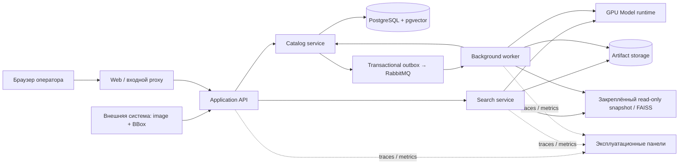

# Целевая архитектура Falcon: сервис, которому заказчик может доверить работу

Дата исследования: 21 сентября 2026 года. Это проект целевой системы, а не описание уже реализованных возможностей. Он основан на предоставленном ТЗ, известной архитектуре текущего ReID-пайплайна и первичной документации инфраструктурных технологий. В документе нет ограничения на бюджет разработки или объём доступных ресурсов. Ограничения конкурса сохраняются.

## 1. Что именно следует построить

**Falcon должен быть рабочим местом для проверяемого визуального поиска автомобиля и одновременно автономным компонентом городской системы.** Оператор загружает обезличенный кадр, задаёт BBox, получает короткий список визуально похожих наблюдений либо обоснованный отказ, сравнивает изображения и сохраняет результат. Интегратор получает тот же результат через документированный API. Администратор обновляет галерею и модель без смешивания версий и без исчезновения уже полученных результатов.

Единицей доверия становится **воспроизводимая поисковая сессия**: исходный кадр, точная рамка, конкретная версия галереи, конкретная модель, правило поиска и правило отказа, фактическая выдача и отдельное решение оператора. Это делает сервис убедительнее эффектного экрана с процентом похожести: результат можно объяснить, проверить и повторить.

ТЗ не просит универсальную платформу видеонаблюдения. В границах продукта остаются image + BBox → embedding → retrieval → candidates/refusal. Детекция, OCR номеров, трекинг, маршруты по карте и автоматическое установление личности владельца в эту архитектуру не входят. Время, камера и координаты не являются входными признаками конкурсного поиска; соответствующие поля нельзя выдумывать из изображения. Обработка потока здесь означает независимую обработку последовательности уже выделенных объектов.

## 2. Архитектурные инварианты

1. **Один смысл результата во всех каналах.** Браузер, публичный API, пакетный экспорт и конкурсный runner используют одно вычислительное ядро. Нет отдельного «демо-алгоритма» с более красивыми ответами.
2. **Один запрос независим от других.** Результат определяется изображением, BBox и закреплённым контекстом поиска. Добавление соседних query, порядок их поступления и количество concurrent пользователей не должны содержательно менять выдачу. Кэширование меняет задержку, но не ответ.
3. **Галерея меняется версиями.** Запрос никогда не попадает между половиной старого индекса и половиной нового. В ответе есть snapshot ID.
4. **Модель — комплект совместимых артефактов.** Encoder, preprocessing, reranker, параметры поиска и calibration policy проверяются совместно. Новый encoder не получает старый порог по умолчанию.
5. **Нет смешения отказа и неисправности.** «Не найдено уверенного совпадения», «галерея ещё готовится», «калибровка неприменима» и «один поисковый узел недоступен» — разные состояния API и интерфейса.
6. **Поисковая гипотеза не становится подтверждённой идентичностью автоматически.** Операторская отметка хранится отдельно от исходного ответа модели. Самообучение на собственных ответах не запускается.
7. **Индекс восстановим.** Векторы, исходные связи и manifest хранятся долговечно; поисковый индекс является производным артефактом, который можно пересобрать.
8. **Вход и результат имеют явные границы доступа.** Workspace/организация — часть каждого объекта, индексного пространства и запроса. Чужие результаты не попадают в shortlist с последующим случайным удалением.
9. **Автономность входит в продукт.** Выключение внешнего интернета не ломает вход, шрифты, Swagger, загрузку модели, поиск, экспорт и наблюдаемость.

Это предложения по устройству сервиса. Они не означают, что перечисленные свойства уже проверены в репозитории.

## 3. Логические компоненты и их продуктовый смысл

| Компонент | Ответственность | Что получает заказчик |
|---|---|---|
| Web workspace — React/TypeScript | Кадр и BBox, результаты, сравнение, история, импорт, экспорт, состояния сервиса | Оператор выполняет задачу без консоли, получает понятный исход даже при отказе |
| Application API — Python/FastAPI | Аутентификация, права, валидация, поисковые сессии, закрепление версий, маршрутизация действий | Единый контракт для браузера и внешних систем; предсказуемые ошибки |
| Catalog service | Владелец галерей, snapshots, глобальных признаков и artifact manifests; транзакции публикации | Галерея обновляется согласованно и не теряется после перезапуска |
| Search service | Global exact/ANN retrieval, объединение shortlist, вызов reranker, confidence policy | Один и тот же математический ответ во всех сценариях |
| GPU Model runtime | Canonical preprocessing, encoder, pair reranker; загрузка совместимого release и ограниченный scheduler | GPU обслуживает запросы предсказуемо, а обновление модели управляемо |
| Background worker | Импорт, индексация, публикация snapshot, экспорты, подготовка объяснения, обслуживание артефактов | Большая загрузка галереи не замораживает работу операторов |
| PostgreSQL + pgvector | Авторитетные метаданные, глобальные векторы, состояния заданий, версии, результаты, аудит | Устойчивое хранение и согласованные изменения, а не данные только в памяти GPU |
| Artifact storage | Кадры, вырезки, patch-признаки, индексы, manifests и экспортные пакеты | Галерея и результаты переживают перезапуск; артефакты проверяются по checksum |
| RabbitMQ + transactional outbox | Доставка заданий импорта/объяснения/экспорта; сообщения содержат ID, а не многомегабайтные изображения | Длительная работа не теряется между записью заявки и запуском worker |
| Telemetry collector и эксплуатационные панели | Метрики, traces, технические события | Эксплуатация видит, почему поиск замедлился, и может проверить состояние поставки |

В целевой системе шесть прикладных компонентов: `web`, `api`, `catalog`, `search`, `model-runtime`, `workers`; PostgreSQL, object storage, RabbitMQ и telemetry — инфраструктура. В автономной поставке они запускаются одним Compose. Допустима совместная упаковка Catalog в API-процесс и Search в inference-процесс, если хочется компактный appliance; контракты, владение данными и вычислительное ядро остаются прежними. Упрощение размещения не означает, что API/worker бесконтрольно пишут в чужие таблицы.

В компактном профиле artifact storage может быть постоянным томом за тем же adapter; в основной целевой топологии это S3-compatible storage внутри организации. Наблюдаемость добавляется профилем Compose. Миграция БД и первичная инициализация выполняются одноразовыми контейнерными задачами автоматически, а не ручным заходом администратора внутрь контейнера. В городской конфигурации encoder/reranker, Search и background workers масштабируются по фактической нагрузке. Это одна доменная архитектура с двумя топологиями, а не два продукта.



Два потока работы отделены семантически. Поиск — короткий синхронный запрос с ограниченным временем ожидания. Импорт, переиндексация и экспорт — долговечные асинхронные задания с прогрессом, отменой и повторным запуском. Не нужно помещать каждый интерактивный поиск в общую очередь с часовым импортом. При необходимости интеграции event adapter принимает отдельные image + BBox события и вызывает то же query-level ядро; message ID, source authorization и момент закрепления serving context определены явно. Наличие потока событий не добавляет модели состояние между автомобилями и не превращает ReID в tracking.

## 4. Выбор хранилища и поиска

Рекомендуемая целевая связка: **PostgreSQL + pgvector для долговечного хранения нормированных global embeddings; FAISS как библиотека производных read-only индексов внутри search-компонента; artifact store для больших бинарных данных.** Это не две конкурирующие базы векторов: у PostgreSQL ответственность за данные и транзакции, у FAISS — за ускоренную выдачу по закреплённой версии. Повторная запись изменяемых данных сразу в два независимых primary store не нужна.

pgvector поддерживает точный поиск, HNSW/IVFFlat, `vector` и другие представления. Его можно использовать и как единственный поисковый backend. В предлагаемой архитектуре достаточно типа `vector` для глобальных признаков и exact SQL-проверок; второй production HNSW поверх той же галереи в PostgreSQL не строится без конкретной потребности. 1152-мерный global embedding совместим с документированным ограничением HNSW для типа `vector` до 2000 измерений. [Документация pgvector](https://github.com/pgvector/pgvector).

FAISS выбирается для версионируемых индексных артефактов: маленькая галерея использует `IndexFlatIP` или эквивалентный проверенный exact kernel, миллион наблюдений — `IndexHNSWFlat` с нормированными векторами. Exact-индекс остаётся эталоном качества ANN. Для нормированных векторов inner product соответствует cosine similarity. [Выбор индекса FAISS](https://github.com/facebookresearch/faiss/wiki/Guidelines-to-choose-an-index), [метрики FAISS](https://github.com/facebookresearch/faiss/wiki/MetricType-and-distances).

Стартовая конфигурация миллионного индекса для исследования: HNSW `M=32`, `efConstruction=200`, несколько значений `efSearch`, shortlist 100–200 объектов, exact rescoring shortlist, pair rerank первых 20. Эти числа — исходная точка испытаний, не найденный оптимум и не гарантия качества. Окончательный search profile выбирается по Pareto-кривой recall/latency и получает собственную версию. Если ANN не выдерживает установленный recall, увеличиваются параметры/ресурсы или применяется exact-поиск; порог уверенности не компенсирует потерянного соседа.

Почему не выбрать только pgvector? Это вполне допустимый более компактный вариант. Но ANN поверх изменяющегося membership фильтра, tenant-фильтра или snapshot-фильтра требует проверки recall: pgvector применяет фильтрацию при approximate scans, а iterative scan расширяет просмотр, но имеет ограничители. Отдельный индекс разрешённого snapshot делает область поиска и публикацию версии очевидными. Если команда выбирает только pgvector, необходимо партиционирование либо материализация пространства поиска и отдельные проверки фильтрованного ANN. [Фильтрация и iterative scans pgvector](https://github.com/pgvector/pgvector#filtering).

RabbitMQ выбран для долговечных фоновых заданий и изоляции их потоков. Добавлять рядом Kafka, Redis, Milvus и сложный кластерный orchestrator только ради «enterprise» вида не нужно. Другая vector DB появляется при установленной потребности: частые изменения огромной галереи, исчерпанная производительность существующих workers, требование оператора инфраструктуры. Масштаб около 10⁶ сам по себе не доказывает необходимость нескольких векторных СУБД.

## 5. Что происходит при одном поиске

1. API проверяет пользователя, область доступа, формат JPEG/PNG, размер файла и декодированного изображения, BBox и `top_n`.
2. В одной логической операции закрепляет `gallery_snapshot_id + serving_release_id + policy_id`. Сохраняет идентификатор запроса и его контекст.
3. Canonical preprocessing декодирует кадр и вырезает `[x, y, x+w, y+h)` в системе координат исходного изображения. Поведение EXIF orientation, округление и выход за границы определяются контрактом и совпадают в UI/API/CLI. По умолчанию некорректная рамка отклоняется с понятной ошибкой; незаметного автоматического исправления нет.
4. Encoder формирует L2-нормированный global embedding и локальные признаки для реранкера. Целевая реализация извлекает оба результата одним проходом, если численный паритет с зафиксированным алгоритмом подтверждён. При отсутствии паритета общий проход считается изменением модели и отдельно валидируется.
5. Search ищет только в закреплённой галерее. Для небольшого набора — exact; для большого — ANN shortlist и exact cosine rescore сохранёнными global vectors.
6. Pair reranker обрабатывает фиксированный shortlist. Локальные признаки кандидатов подготовлены при импорте; запрос не запускает повторно encoder для двадцати кандидатов при каждом обращении.
7. Decision policy формирует ранжирование и accepted candidates. Порог применяется ровно в той математической постановке, в которой он калибровался.
8. API сохраняет завершённый ответ с версиями и возвращает его браузеру. Объяснение выбранной пары, если нужно, рассчитывается отдельной операцией и не задерживает основной поиск.

У результата два понятия: **порядок сходства** и **допуск к предложению оператору**. Сервис умеет получить top-N при отсутствии уверенного совпадения; это ещё не разрешение показать эти изображения как найденный автомобиль. Основной ответ при отказе содержит `accepted_candidates: []`. Дополнительный просмотр ближайших примеров доступен явно как диагностический сценарий и визуально отделён от принятых кандидатов. Экспорт режима отказа использует только accepted candidates.

В базовом профиле с top-1 policy принятый список содержит только итогового первого кандидата либо пуст. Остальной top-N — ранжированные альтернативы, а не автоматически принятые совпадения. Для принятия нескольких пар требуется отдельно проверенная policy.

`top_n` ограничивает размер ответа, а не меняет состав calibration population и не меняет score top-1. Технические параметры ANN и threshold не являются произвольными пользовательскими query-параметрами. Область поиска заранее совпадает с доступной пользователю галереей: запрещено искать по общей базе, считать confidence по ней, а затем скрыть чужие карточки. Выбор поднабора/новый ACL меняют search universe и требуют применимого calibration profile. Если профиль не покрывает такой фильтр, сервис сообщает об этом до выдачи уверенного решения.

## 6. Галерея: жизненный цикл и публикация

**Галерея — именованная коллекция, snapshot — неизменяемый поисковый срез этой коллекции.** Её состояния:

```text
draft → validating → embedding → indexing → verifying → ready → active → retired
                         ↘ failed / cancelled
```

Snapshot содержит ordered manifest наблюдений, content hashes, модель признаков, ссылки на признаки, mapping внутреннего index ID к observation ID, параметры индекса, версию confidence policy, summary качества входных данных, ожидаемое число объектов и checksum каждого артефакта. `active` — атомарно переключаемый указатель, а не разрешение менять опубликованные файлы.

При импорте оператор сначала видит отчёт: сколько объектов принято, сколько строк некорректны, какие изображения отсутствуют, где BBox выходит за границы. Можно скачать исправляемый CSV с причинами ошибок. Частичная загрузка никогда не становится молча «полной галереей». Публикация допустимого подмножества требует явного выбранного режима и сохраняет число исключённых объектов.

Worker сохраняет данные стадиями, подтверждает checksum и паритет размеров, собирает индекс в новом namespace. Новый snapshot становится готовым после проверки индекса, заполненности признаков и применимости calibration profile. Перед публикацией Search и Model workers загружают нужные artifacts, сверяют checksum, выполняют warmup и подтверждают готовность обслуживать точный serving context. Catalog проверяет достаточность готового пула и только затем переключает active pointer транзакционно с проверкой ожидаемого старого номера версии. Маршрутизатор направляет query лишь в replicas, заявившие готовность к закреплённому context. Это защищает и от холодного индекса после публикации, и от двух одновременных администраторов с потерянным обновлением.

Уже выполняющиеся query завершаются на старом snapshot. Новые получают новый. Повтор после транспортного сбоя использует первоначально закреплённую версию; нельзя незаметно повторить его на новой active gallery. Старые read-only артефакты сохраняются, пока на них есть выполняющиеся запросы или действует срок хранения воспроизводимых сессий. В UI видно: «Поиск выполнен по версии галереи от …; сейчас доступна новая версия» с отдельным действием повторить поиск. Если warmed worker умер после публикации, запрос идёт в другую готовую replica того же контекста либо получает техническую ошибку; fallback на другую модель/галерею исключён.

Изменение BBox, исходного изображения или preprocessing создаёт новый feature revision. Изменение отображаемого названия не обязано пересчитывать embeddings. Добавление наблюдения не связывает его с существующим автомобилем по одному сходству автоматически. Известный `vehicle_id`, если законно предоставлен источником галереи, является внешним атрибутом, а не модельной догадкой.

Для постоянного поступления данных используется один механизм immutable micro-snapshots: небольшие замороженные delta-сегменты плюс основной индекс, общий manifest закрепляет оба. Периодическая compaction собирает новую базовую версию. Поиск объединяет кандидатов всех сегментов; policy получает размер и состав полной опубликованной коллекции. Не нужно перестраивать миллион объектов для каждого нового кадра или обновлять общий индекс из параллельных query threads.

Отзыв доступа и удаление данных имеют приоритет над удобством воспроизведения. Отозванный объект блокируется в выдаче/экспорте, создаётся очищенный snapshot; артефакты удаляются по принятой политике хранения. Старый отчёт сохраняет факт удаления, а не скрытую возможность обойти его через старую ссылку. После изменения доступного состава галереи применимость калибровки оценивается снова.

## 7. Уверенность — полноценный контракт, а не подпись у картинки

Порог связан как минимум с encoder, preprocessing, precision, reranker, fusion, определением score, candidate policy, типом/параметрами retrieval и распределением галереи. Поэтому `calibration_profile` содержит:

- версию алгоритма и полный score contract;
- какие validation identities и open-set сценарии использованы, без смешивания train/test;
- правило получения threshold и метрики на независимой проверке;
- размер/состав галерей в проверке и допустимую область применения;
- число положительных/отрицательных примеров, показатели F1/TNR/precision/recall, интервалы неопределённости;
- состояние: `validated`, `outside_scope`, `unavailable`, `retired`.

Для оператора можно предусмотреть «Стандартный» и «Осторожный» режимы, **только если оба заранее откалиброваны** и объясняют цену компромисса. Это два именованных policy, а не ползунок, с помощью которого оператор случайно делает порог бессмысленным. В конкурсном профиле закрепляется один объявленный вариант.

Число вроде z-score не превращается в «97%» умножением на коэффициент. Процент допустим только при отдельной проверенной вероятностной калибровке в сопоставимой области. До этого UI показывает уровень/статус уверенности и подробности числовой шкалы. Даже калиброванная вероятность сопровождает конкретную гипотезу и область проверки, а не обещание установить автомобиль без ошибки.

Существующая ловушка малой галереи должна быть исключена архитектурно. Если используется z-score по всем N gallery similarities с population standard deviation, максимум не превосходит `sqrt(N−1)`. Порог 7,2429 математически недостижим при N≤53. N≥54 устраняет только это ограничение, но не доказывает применимость порога. Поэтому маленькое демо нельзя «оживить» произвольным снижением threshold. Нужен отдельно валидированный small-gallery policy либо честный `calibration_unavailable`.

При ANN запрещено заменять среднее/дисперсию полной галереи статистикой top-20: это уже другая оценка. Если сохраняется такой score, snapshot может содержать полные моменты global vectors: `m = mean(g)`, `C = mean(ggᵀ) − mmᵀ`; для нормированного q получаем `μ = qᵀm`, `σ² = qᵀCq`. Это архитектурное предложение, требующее проверки численной точности. Точные моменты не исправляют пропуск лучшего соседа ANN и не делают threshold переносимым между любыми галереями.

Отсутствие ground truth в production не позволяет называть статистику уверенности «текущей точностью модели». Отдельно показываются качество входов и распределение scores, отдельно — измеренная точность на размеченных контрольных наборах. Операторские подтверждения проходят процесс проверки перед использованием в новой обучающей/калибровочной версии; текущая система не меняется после каждого клика.

## 8. Обновление модели и rollback

`Serving release` — manifest с версиями кода, encoder weights, preprocessing, dimension/normalization, precision, reranker/projection weights, fusion, retrieval profile, calibration profile и совместимых schema. Каждый файл имеет checksum. Суммарный размер всех необходимых модельных весов конкурсной поставки укладывается в 2 ГБ; несколько альтернативных encoder, auxiliary weights или экспортированных копий модели тоже нужно учитывать, а не прятать за названием «служебные».

Новый release проходит цепочку `registered → evaluated → staged → warmed → active → retired`. Для нового encoder галерея пересчитывается параллельно. Новая версия индекса никогда не сравнивается со старыми query embeddings. Во время shadow-проверки сервис может посчитать дополнительный результат, но не смешивает две выдачи и не выдаёт shadow как действующий результат.

Переключается атомарно весь serving context: `model release + gallery snapshot + search profile + confidence policy`. Старый контекст остаётся готовым для rollback; в интерфейсе администратора до активации видны изменения качества, времени, applicability и размеры артефактов. Чужие train/test данные, скрытые ответы и подтверждения текущего production не попадают в эту проверку без отдельного оформленного набора.

В локальной конкурсной поставке поставляется один финальный комплект весов в пределах лимита; промышленное хранилище истории релизов не подменяет требования к размеру сдаваемого решения. Rollback промышленной версии не требует упаковывать весь исторический model registry в конкурсный архив.

Triton может быть adapter для промышленного GPU-serving: его dynamic batcher поддерживает stateless models, ограничение задержки формирования batch, priority queues и queue policies. Это полезно для большой параллельной нагрузки, если подтверждён паритет serving backend. Он не обязателен для одного A5000 и не заменяет app-level version pinning, gallery consistency и calibration. [Документация Triton dynamic batching](https://docs.nvidia.com/deeplearning/triton-inference-server/user-guide/docs/user_guide/batcher.html).

## 9. Схема данных

| Сущность | Основные поля и смысл |
|---|---|
| `workspace` / `membership` | Организация, роли, разрешённые действия и коллекции |
| `asset` | ID, workspace, storage key, hash, mime, размеры, источник, срок хранения; исходное изображение |
| `observation` | ID, asset ID, BBox, external observation ID, optional supplied identity; один автомобиль в одном кадре |
| `feature_revision` | observation ID, encoder/preprocess/precision ID, global vector, token artifact reference, token_spec/projection/reranker hash при предвычисленной проекции, checksum |
| `gallery` | Имя, workspace, владелец, active snapshot pointer |
| `gallery_snapshot` / `snapshot_member` | Неизменяемый набор observation/feature revisions, index manifest, count, state |
| `model_release` / `search_profile` / `calibration_profile` | Проверенный комплект поведения и ограничения применимости |
| `search_session` | Запрос, input reference/hash, bbox, actor, serving context, outcome, timings, request ID |
| `candidate_result` | Session, observation ID, rank, raw similarity, ranking score, decision score, accepted flag |
| `operator_review` | Session/candidate, подтверждение/отклонение/неопределённость, автор, комментарий, revision |
| `job` | Тип, payload reference, idempotency key, lease, attempt, progress, state, output manifest |
| `audit_event` | Кто, что, над каким объектом, когда, outcome, correlation ID |
| `export_artifact` | Session/snapshot IDs, формат, object key, checksum, scope, expiry |

Один image ID может иметь несколько BBox, поэтому image и observation не объединяются. Векторы разных моделей не хранятся под одинаковым неявным ключом. Численные tensors не передаются через огромные JSON-массивы между внутренними сервисами без необходимости; клиенту достаточно результатов, а публичный embedding endpoint имеет явный формат и версию. Dataset row order для `embeddings.npy` хранится отдельным mapping, а не восстанавливается случайной сортировкой UUID.

## 10. API, идемпотентность и состояния

Все публичные операции описываются одной зафиксированной OpenAPI-спецификацией с примерами успеха/отказа/ошибок. Внутренние HTTP API имеют собственные спецификации. Использование другой транспортной обвязки inference не делает публичные контракты неявными. Версию спецификации выбирают совместимой с toolchain и фиксируют в поставке; «latest» не является контрактом. [OpenAPI Specification](https://spec.openapis.org/oas/latest.html).

| Метод | Назначение |
|---|---|
| `POST /v1/embeddings` | Изображение + BBox → embedding и идентификатор совместимого пространства признаков |
| `POST /v1/searches` | Синхронный поиск; multipart image или ранее загруженный scoped asset ID, BBox, gallery ID, top_n, именованная policy |
| `GET /v1/searches` | История доступных результатов с пагинацией |
| `GET /v1/searches/{id}` | Неизменённый результат с закреплёнными версиями и отдельно последующими review |
| `POST /v1/searches/{id}/replays` | Повтор на первоначально закреплённом комплекте либо причина невозможности |
| `POST /v1/searches/{id}/reviews` | Отметка оператора, не изменение scores модели |
| `POST /v1/searches/{id}/explanations` | Асинхронное объяснение выбранной пары с версией метода |
| `POST /v1/galleries` | Создание коллекции |
| `POST /v1/galleries/{id}/imports` | Изображения + manifest, возвращает `202` и job ID |
| `GET /v1/galleries`, `GET /v1/galleries/{id}/versions` | Доступные галереи и история snapshot-версий, готовность, число объектов, calibration scope |
| `POST /v1/galleries/{id}/versions/{version}/activate` | Публикация готового snapshot с expected current revision |
| `GET /v1/jobs/{id}` | Прогресс, ошибки строк, итоговый артефакт |
| `POST /v1/jobs/{id}/cancellation` | Запрос кооперативной отмены |
| `POST /v1/searches/{id}/exports` | Отчёт по результату; массовый и конкурсный экспорт имеют отдельные адаптеры того же ядра |
| `GET /v1/observations/{id}/image`, `GET /v1/observations/{id}/crop` | Авторизованное чтение оригинала и crop |
| `GET /v1/exports/{id}/download` | Авторизованное скачивание готового файла |
| `GET /v1/capabilities` | Поддерживаемые форматы, лимиты, доступные policy и модель без раскрытия секретов |

Пример содержания search response; значения заменены placeholders, это описание контракта:

```json
{
  "search_id": "search_...",
  "status": "completed",
  "decision": "no_confident_match",
  "gallery_snapshot_id": "snapshot_...",
  "serving_release_id": "release_...",
  "search_profile_id": "exact_v1",
  "calibration_profile_id": "policy_...",
  "score_type": "versioned_decision_score",
  "accepted_candidates": [],
  "quality_flags": [],
  "diagnostics_available": true,
  "trace_id": "trace_..."
}
```

Ошибка API имеет стабильный `code`, короткое человекочитаемое сообщение, поле/объект причины и request ID. Примеры: `INVALID_BBOX`, `UNSUPPORTED_IMAGE`, `GALLERY_NOT_READY`, `CALIBRATION_UNAVAILABLE`, `MODEL_SNAPSHOT_INCOMPATIBLE`, `QUEUE_FULL`, `SEARCH_INCOMPLETE`. Валидный отказ — завершённая операция `200`; неприменимая калибровка в calibrated-search endpoint — явный конфликт контекста `409`, а не `200` с выдуманным отказом. Для получения необязательного диагностического ранжирования без calibration используется отдельный явно названный режим.

`Idempotency-Key` действует в scope пользователя/workspace + операция + hash canonical payload. Повтор с тем же содержимым возвращает тот же job/search ID; другой payload с прежним key даёт conflict. Для импорта есть дедупликация на asset hash + BBox + feature specification. Это не означает, что повторный снимок автоматически считается тем же автомобилем.

Фоновые задачи допускают повтор доставки. Гарантия — идемпотентное выполнение стадий и единственная публикация завершённого manifest, а не обещание абстрактного exactly-once. Catalog одной транзакцией записывает job и outbox event. Relay передаёт event ID в RabbitMQ с publisher confirm; потеря соединения может привести к повторной доставке и не должна приводить к двойной публикации snapshot. Worker использует lease/heartbeat и checkpoints в БД, сохраняет результат стадии, затем подтверждает сообщение. Отдельные очереди для import, explain и export с ограниченными prefetch/retries не позволяют тяжёлому импорту вытеснять интерактивную работу. Исчерпанные retries переводят job в видимое failed-state и служебную очередь разбора; автоматического бесконечного requeue нет. Publisher confirms и consumer acknowledgements решают разные части доставки. [RabbitMQ: confirms и acknowledgements](https://www.rabbitmq.com/docs/confirms).

В городской отказоустойчивой топологии для критичных фоновых задач можно использовать replicated quorum queues; тип и размер кластера фиксируются в deployment profile. Сам по себе реплицированный broker не делает бизнес-операцию exactly-once. [RabbitMQ quorum queues](https://www.rabbitmq.com/docs/quorum-queues). Для outbox relay PostgreSQL `SKIP LOCKED` пригоден, чтобы несколько relay не захватывали одни rows; он не используется для получения согласованного среза галереи. [PostgreSQL SELECT: locking clauses](https://www.postgresql.org/docs/current/sql-select.html).

## 11. Две топологии эксплуатации

### Автономный комплект для жюри и отдельного учреждения

Linux + NVIDIA GPU, контейнеры выше, постоянные data volumes, заранее поставленные образы и веса, встроенные UI assets и документация. Одна команда запускает систему, проверяет checksum, применяет миграции, поднимает сервисы и сообщает URL/готовность. Эксплуатационный запуск не выполняет `pip install`, `git clone` или скачивание весов.

Пакет поставки содержит исходники, lockfiles, Dockerfiles, Compose, manifests/лицензии, веса, образы, инструкции и сценарий офлайн-проверки. Docker поддерживает сохранение образов в архив и обратную загрузку; оболочка запуска может выполнить импорт автоматически, если нужные images отсутствуют. [Docker image save](https://docs.docker.com/reference/cli/docker/image/save/), [Docker image load](https://docs.docker.com/reference/cli/docker/image/load/).

Три воспроизводимых профиля: `service` для браузера/API, `submission` для CSV/NPY и `benchmark` для официального замера. Пакетный профиль работает из того же inference image без зависимости от web/БД: snapshot adapter читает выданный набор, ядро остаётся прежним. Benchmark не конкурирует с открытой GPU-службой или фоновым импортом. Выходы публикуются после проверки целиком: top-10, dtype/shape/order NPY, формат accepted candidates, manifest и logs.

Однокомандный запуск имеет явно указанные системные предпосылки: подходящий Linux, Docker/Compose, доступный NVIDIA runtime/driver и диск. Сам сервис не требует дополнительных ручных манипуляций после готовности этого host. Структура Compose описывает разные сервисы, volumes, healthchecks и profiles. [Документация Compose services](https://docs.docker.com/reference/compose-file/services/).

### Городская инсталляция

API и UI — несколько replicas за входным proxy; inference — выделенный online GPU pool; import/reindex — отдельный pool; PostgreSQL — отказоустойчивая установка с проверяемым восстановлением; images/tokens/indexes — внутреннее object storage; каждый search worker имеет локальную копию необходимых immutable индексов и hot token data. Требование автономности от публичного интернета остаётся.

Собственное on-premise S3-compatible хранилище может быть реализовано Ceph Object Gateway или предоставлено заказчиком. Конкретную систему выбирают по его инфраструктуре; API хранения не содержит Amazon-specific зависимости. Ceph документирует S3-compatible интерфейс, но совместимость нужных операций проверяется отдельно. [Ceph Object Gateway](https://docs.ceph.com/en/latest/radosgw/).

При миллионе global vectors сначала масштабируем replicas: одна полная галерея на поисковом узле часто позволяет сохранить простую модель ответа. Шардинг вводится по реальному объёму/нагрузке. Если он нужен, manifest фиксирует состав shard, query fan-out обращается ко всем требуемым shard, merge делает общий shortlist, затем rerank/calibration выполняются в согласованном контексте. Потеря shard даёт `SEARCH_INCOMPLETE`, а не ложное «такой машины нет».

Разделение online и offline GPU pools имеет продуктовый смысл: массовая индексация не мешает срочному поиску оператора. В одном A5000-профиле тот же смысл обеспечивают ограниченная очередь и приоритет online-запросов; неограниченный backlog исключён. CPU exact/ANN индексы читаются конкурентно, а публикация нового происходит заменой ссылки. FAISS отдельно предупреждает, что CPU concurrent read-only searches и GPU thread-safety имеют разные условия; один GPU index нельзя свободно использовать из произвольного набора потоков. [FAISS threading](https://github.com/facebookresearch/faiss/wiki/Threads-and-asynchronous-calls).

## 12. Масштаб памяти без рекламных обещаний

При известных размерностях текущего направления вычислительная оценка для миллиона наблюдений:

| Представление | Сырые bytes | Десятичный объём |
|---|---:|---:|
| Global 1152 × float32 | 1 000 000 × 1152 × 4 | 4,608 ГБ |
| Patch tokens 256 × 1152 × float16 | 1 000 000 × 256 × 1152 × 2 | 589,824 ГБ |
| Projected tokens 256 × 256 × float16 | 1 000 000 × 256 × 256 × 2 | 131,072 ГБ |

Это собственные арифметические оценки, не замеры текущего runtime. Сетка 256 токенов предполагает 224/14; реальные tensor shapes и законность предвычисления проекции проверяются на выбранном encoder/reranker. Сюда не входят PostgreSQL overhead, HNSW graph, snapshots, реплики, images, индексы, serving buffers и резервирование. Форматы/накладные расходы FAISS описаны отдельно. [Таблица индексов FAISS](https://github.com/facebookresearch/faiss/wiki/Faiss-indexes).

При достаточных ресурсах разумно предварительно считать и долговечно хранить нужные reranker tokens для всей опубликованной галереи, а hot рабочий набор держать на локальном NVMe/RAM. Ленивая повторная обработка двадцати полных снимков при каждом поиске ухудшает стабильность задержки. Сжатие/проекция tokens используются только при доказанном математическом соответствии выбранному реранкеру; экономия места не оправдывает незаявленное изменение качества.

Демонстрация million-scale должна отдельно показывать: dataset provenance, число изображений и уникальных машин если оно известно, ANN recall относительно exact, p50/p95/p99 полного поиска, ingest throughput, размер индекса, hot/cold token path и качество отказов. Миллион случайных векторов доказывает только часть capacity, но не работу визуального поиска на миллионе уникальных автомобилей.

## 13. Доступ, аудит и эксплуатационная надёжность

Роли продукта: оператор ищет и сохраняет review; куратор управляет галереями; администратор публикует model/policy и управляет доступом; аудитор читает историю и отчёты. В городской системе идентификация связывается с внутренним Identity Provider заказчика; в автономной поставке предусмотрена локальная аутентификация без внешнего SaaS. Права проверяются на asset, gallery, snapshot, session, job и export, включая фоновые действия и повторное скачивание.

PostgreSQL RLS можно использовать как дополнительный слой изоляции. Сервисный пользователь не должен иметь роли, обходящие RLS: владельцы таблиц и `BYPASSRLS`/superuser обладают особыми правилами, поэтому простого `ENABLE ROW LEVEL SECURITY` недостаточно. [PostgreSQL row security](https://www.postgresql.org/docs/current/ddl-rowsecurity.html).

Изображения и векторы не доступны из публичного object bucket. API не принимает произвольные URL и host filesystem paths. Проверяются MIME/декодирование, лимит пикселей и размера архивов, имена archive entries, BBox и количество объектов. Secrets не попадают в images/frontend/logs; runtime не запускается от root, writable paths ограничены данными и временным каталогом. Внешние запросы системе не нужны для основного результата.

Аудит фиксирует импорт, изменение доступа, публикацию snapshot/model/policy, поиск, review и экспорт. В logs пишутся trace ID, версии, время стадий и коды ошибки, а не фото, embeddings, cookies и bearer tokens. Экспортный пакет включает manifest/checksums и отображает машинный результат отдельно от решения оператора. При необходимости заказчика журнал делается защищённым от незаметного изменения, но «юридически значимое доказательство» не заявляется без отдельного процесса и требований.

Сбои имеют заранее заданное поведение: повреждённый token artifact — техническая ошибка/переиндексация, а не незаметное отключение reranker; перегрузка — ограниченное ожидание или `429/503`; неготовая модель — отсутствие readiness; частичная галерея — запрет выдавать полный calibrated result. Можно определить отдельный degraded search profile без реранкера, но у него должны быть собственные version/policy/quality evidence, и пользователь видит его явно.

Liveness отвечает за жизнь процесса. Readiness — за готовность принимать соответствующую работу. Готовность конкретной gallery проверяется отдельно и содержит причины. Backups считаются полезными после испытания restore вместе: PostgreSQL state + model manifests + feature/artifact references. Наличие архива без восстановленного поиска не является доказательством восстановления.

## 14. Наблюдаемость и предлагаемые SLO

OpenTelemetry подходит как единый формат traces/metrics/logs с внутренним Collector. Он принимает, обрабатывает и экспортирует telemetry; конкретное хранилище и панели выбираются под эксплуатацию заказчика. Внешний облачный telemetry backend не обязателен. [OpenTelemetry Collector](https://opentelemetry.io/docs/collector/).

Оператору достаточно состояния доступности, версии/размера галереи и объяснения ожидания. Инженеру нужны графики: время decode/crop/encode/search/rerank/decision, queue wait, active requests, error codes, GPU memory, token cache misses, job age, snapshot publication lag. Нельзя смешивать p95 feature extraction с p95 полного поиска.

Ниже **предлагаемые цели проектирования**, которые затем принимаются по измерениям; это не требования ТЗ и не достигнутые показатели:

| Показатель | Предлагаемая цель | Условия проверки |
|---|---|---|
| Визуальная реакция UI на действие | До 150 мс для локальной реакции | Подтверждение действия/индикатор, не обещание закончить модельный расчёт |
| Полный интерактивный поиск, небольшая gallery | p95 ≤ 500 мс в целевой конфигурации | Файл уже принят сервером; включает decode, очередь, модель, retrieval, rerank, сохранение ответа |
| Полный поиск по 10⁶ observations | p95 ≤ 500 мс на прогретом профиле | Заявленные concurrency, GPU/CPU/RAM, размеры файлов, tokens включены; cold profile отдельно |
| ANN recall@20 против exact | ≥ 0,995 как отправная целевая граница | Репрезентативные query; дополнительно измеряется влияние на ReID и refusal |
| Доступность городского API | 99,95% за месяц как целевой ориентир | Согласованный SLI; штатный отказ поиска не является outage |
| Время публикации нового snapshot | Фиксируемое и наблюдаемое для каждого размера | Отдельно ingest/embedding/index/warmup; цифры до измерения не назначаются |
| Восстановление/rollback | Цель задаётся после выбранной топологии и rehearsal | Измеряется фактическое восстановление возможности искать, а не только старт контейнера |

Официальные feature latency/FPS измеряются по скрипту организаторов на их оборудовании. ТЗ не задаёт универсальный порог «40 мс» или готовую цифру E2E; произвольный красивый benchmark нельзя представлять официальным зачётом. Конкурсные 2 ГБ и отсутствие OOM не отменяются большой собственной инфраструктурой.

## 15. Чистый код как свойство архитектуры

Рекомендуемая структура — небольшой монорепозиторий с независимыми приложениями, одним доменным ядром и явными adapters; количество deployable services не требует отдельных репозиториев с копированием алгоритма.

```text
packages/reid_core/       # типы, preprocessing, encode, rank, decision
packages/contracts/      # схемы, ошибки, версии OpenAPI
services/api/            # orchestration, auth, browser/integration contracts
services/catalog/        # gallery/features/snapshots, транзакции и outbox
services/search/         # exact/ANN adapters, shortlist, policy и composition ядра
services/model_runtime/  # загрузка release, bounded scheduler, encoder/reranker
services/worker/         # импорт, публикация snapshot, экспорт, explain jobs
web/                     # операторский интерфейс
adapters/submission/     # официальный формат из того же ядра
adapters/events/         # независимый image+BBox event, то же ядро и policy
deploy/                  # Compose и выбранная промышленная топология
docs/                    # ADR, API, runbooks, модель данных, воспроизведение
tests/                   # предметные контракты и интеграция
research/                # обучение/эксперименты вне зависимости serving
```

Это целевые границы, а не требование переставить все существующие файлы ради красоты. Доменное ядро не импортирует FastAPI, ORM, Redis, UI, dataframe train-pipeline или конкретный object store. Внешние компоненты зависят от узких контрактов ядра. Конфигурация типизирована, переносима и проверяется при старте. Преобразования и fallback не спрятаны в endpoint handlers.

Проверяется содержательная чистота: один BBox contract, один normalization, один порядок tie-break, один ranking/refusal contract, явные schemas и отсутствие неиспользуемых режимов. Тесты должны ловить предметные ошибки: query independence; соответствие batch/single; ошибка версии модели; неполный shard; переключение snapshot во время запросов; повтор импорта; отказ и техническая ошибка; права на чужую session/export; restart/restore; format/order официальных артефактов. Численный паритет, GPU benchmark и офлайн-воспроизведение идут отдельными доказательствами, а не замещаются большим числом mock-тестов.

## 16. Что особенно впечатлит заказчика в этой архитектуре

- **Версия галереи видна в каждом результате.** Заказчик понимает, по какой базе выполнен поиск и почему повтор после обновления отличается.
- **Импорт не ломает текущую работу.** На экране растёт прогресс нового набора, оператор продолжает искать в действующем; публикация меняет версию без смеси данных.
- **Отказ имеет правильный смысл.** Пустая выдача подтверждает завершённый поиск в доступной области, а не прячет неготовую базу или ошибку модели.
- **Одна кнопка собирает проверяемый пакет.** Кадр, BBox, найденные пары, версии, policy и операторское решение можно передать коллеге и воспроизвести.
- **Есть настоящая демонстрация смены версии и rollback.** Показывает управляемость модели, которую нельзя оценить красивой сеткой изображений.
- **Рабочая автономная поставка.** Сеть отключена, контейнеры перезапущены, галерея сохранилась, поиск и экспорт работают.
- **Миллионный поиск проверяется рядом с exact-эталоном.** Видны время и потери ANN; достоинства системы не зависят от скрытого маленького демонабора.

Сильная защита такой архитектуры звучит конкретно: «Мы отдаём автономный сервис визуального поиска с управляемой галереей, честным отказом, проверяемыми результатами и понятным путём до городского масштаба». Это архитектурный способ подкрепить качество модели; дополнительных баллов вне опубликованных правил и гарантии первого места он не создаёт.
